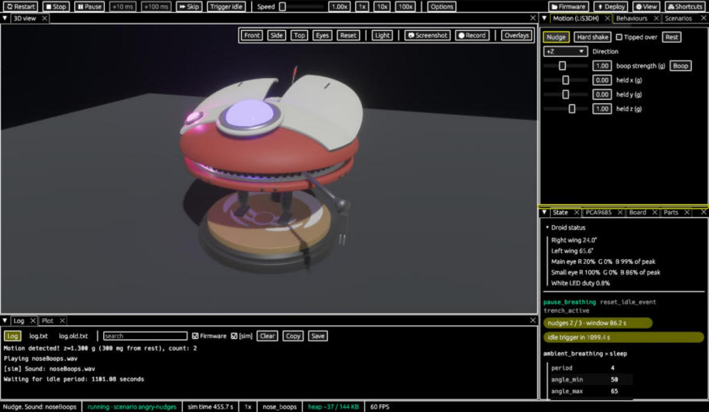

# Accessibility

The simulator can be used with a screen reader, by voice, with the keyboard only, and in high contrast. Nothing depends on hearing a sound or seeing a colour.

## With a screen reader (Narrator, NVDA)

1. Start your screen reader. For Narrator press **Win+Ctrl+Enter**.
2. Open `ddl0-sim.exe`.
3. Press **Tab** and **Shift+Tab** to move between buttons, **Enter** to press one.
4. Press **F6** to move from panel to panel.

What it reads:

- **The status line** reads every new event aloud by itself, such as *Boop 1.0 g*, *Sound: noseBoops* or *Now angry animation*, without moving your focus.
- **Droid status**, at the top of the **State** panel, says what Lola is doing: her wing angles, eye colours and white light. One Tab stop per line.
- **The Plot's Table button** turns the graphs into rows such as *Wings R: latest 57°, min 50°, max 65°*.
- **Sounds** are written in the **Log** as `[sim] Sound: angry.wav`. To read the log, use Narrator's scan mode (**Caps Lock+Space**, then the arrow keys).

## By voice (Windows Voice Access)

Turn on Voice Access in Windows (*Settings > Accessibility > Speech*). Then say **"click"** and the button's name, exactly as on screen:

- *click Nudge*, *click Hard shake*, *click Boop*, *click Trigger idle*
- *click Restart*, *click Pause*, *click Resume*
- *click Front*, *click Reset view*, *click Log*, *click Table*

Some buttons look the same, so they have longer spoken names: *click Reset view* or *click Reset plot*; *click Save parts* or *click Save log*. For anything else, say its key, such as *press B*.

## With the keyboard only

- **Tab** / **Shift+Tab** and the arrow keys move between controls; **Enter** presses.
- **F6** / **Shift+F6** move between panels.
- **Ctrl+K** opens the command palette, which can run every action by name.
- To move the camera: **F6** until the *3D view* tab is active, then **Tab**. Now the arrows turn, **Shift**+arrows slide, **+**/**−** zoom and **Home** resets. **Esc** leaves.
- **B** boops Lola, using the **Motion (LIS3DH)** panel's *Direction* and *boop strength (g)*.

The full list is on [Layouts, themes and shortcuts](Layouts-Themes-and-Shortcuts), or press **F1** in the app.

## Seeing it clearly

- **High contrast:** **⚙ View > Theme > High contrast**. With *Follow system*, a Windows contrast theme switches it on by itself.
- **Bigger text:** **Ctrl+=**. The app follows Windows' *Text size* until you change it.
- **Less movement:** untick **⚙ View > Animations** to stop gliding and fading. It follows Windows' *Animation effects* until you change it; **Follow Windows** goes back.
- Every theme meets WCAG 2.2 AA contrast, and the plot colours are safe for colour blindness.

## Known limits

- Tested with Narrator through Windows UI Automation, not by ear. NVDA, JAWS and Dragon haven't been tested.
- Screen readers are tested on Windows only. The Linux and Mac versions expose the same controls, but Orca and VoiceOver are untested. Voice Access and the Windows settings above are Windows features; on a Mac, *Follow system* reads dark mode, *Increase contrast* and *Reduce motion*, and on Linux it reads GNOME's settings.
- A few dock controls (collapse and close-all buttons, scroll bars, the dividers) have no names. Each panel's *×* and the command palette do the same jobs.
- After **Del** deletes a part, focus goes back to the window. Press **F6** to return to a panel.

Something doesn't work for you? Please [open an issue](https://github.com/Aiddy81/DD-L0-LA59-Animatronics/issues/new). Accessibility bugs are bugs.

## More detail (for tinkerers)

- Controls are exposed through AccessKit to Windows UI Automation, which Narrator, NVDA, JAWS and Voice Access read.
- The status line is a polite live region: at most one message every 1.5 s, events at the same moment joined, errors never dropped.
- `ddl0-sim-tests.exe every_theme --nocapture` prints every theme's contrast pairs.
