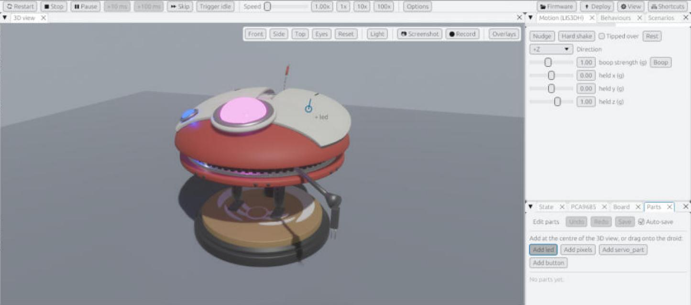

# Adding new hardware (no Rust needed)

> **You'll need:** the simulator · **Time:** 15 minutes for a part, longer for a shim

Want to give Lola a new light, a button or a moving flap? You can see it in the simulator before you build it, without changing the simulator's own code.

There are two steps:

1. **Put the part on the 3D droid** with the **Parts** panel. This is enough for anything wired to a servo-board channel or a board pin.
2. **Write a shim** only if the part uses a library the simulator doesn't know yet, like `neopixel`.

## Step 1: put a part on the droid

The simulator has four kinds of part:

| Kind | Looks like | Good for |
|---|---|---|
| `led` | a glowing ball | any single light, one colour or RGB |
| `pixels` | a row or ring of dots | NeoPixel strips and rings |
| `servo_part` | a box or cylinder that turns on a hinge | flaps, tails, ears |
| `button` | a cap you can press with the mouse | buttons, switches, touch pads |

1. Open the **Parts** panel (**⚙ View > Parts** if you can't see it).
2. Drag **Add led** (or another kind) onto Lola where you want it. A ring shows where it will land.
3. Let go. The part appears, is selected, and **Edit parts** turns on.
4. In the part's settings, choose its **source**:
   - **PCA channel**: it follows a servo-board channel (0–15), like the wings and eyes.
   - **Pin**: it follows a board pin, such as `D5`.
   - **Shim only**: a shim drives it (Step 2).
5. Drag the part to slide it over the surface, or type exact **Position** and **Rotation°** values. **Nudge** buttons move it a step.
6. With **Auto-save** on (the default), it's saved to `simulator/parts.toml` straight away.
7. Turn **Edit parts** off to boop Lola and press buttons again.
8. Click **🔄 Restart**. The part now shows whatever the firmware sends to its channel or pin.

**Without a mouse:** turn the camera so the spot you want is in the middle of the 3D view, then press **Add led** with the keyboard (Tab and Enter). It lands in the middle of the view.

Made a mistake? **Undo** (**Ctrl+Z**) and **Redo** (**Ctrl+Y**), or **Delete part** (**Del**).

### ✅ It should look like this

The **PCA9685** panel lists your part with its source and live value, and it lights up or moves when the firmware drives it.

## Step 2: write a shim (only if needed)

If your firmware does `import neopixel` (or another library the simulator doesn't model), the **Board** panel lists it as *not simulated*. The code keeps running but nothing shows. A **shim** is a small Python file that pretends to be that library and tells the simulator what to show.

1. Make a folder called `shims` next to `ddl0-sim.exe` (in `simulator\dist\`).
2. Put your shim there, named like the library: `neopixel.py`.
3. In it, call the simulator through `simhw`:
   - `simhw.set_part(name, value)`: brightness, colour or angle for an `led`, `pixels` or `servo_part`.
   - `simhw.set_pixels(name, [(r, g, b), …])`: one colour per dot.
   - `simhw.part_input(name)`: is a `button` held down?
4. Click **🔄 Restart**. The log names each shim it loaded from that folder.

The [shim guide](https://github.com/Aiddy81/DD-L0-LA59-Animatronics/blob/main/simulator/docs/custom-shims.md) has the full rules and four worked examples. **[Example D](https://github.com/Aiddy81/DD-L0-LA59-Animatronics/blob/main/simulator/docs/custom-shims.md#example-d-a-neopixel-ring-and-a-touch-pad-with-no-rust-neopixel-touchio)** is a complete NeoPixel ring and touch pad you can copy.

## ⚠️ Something went wrong?

| Problem | Fix |
|---|---|
| *Add led* does nothing and the log says the centre isn't on the droid | Turn the camera so Lola is in the middle of the view, or drag the button onto her instead. |
| `[sim] parts.toml part N ("name") skipped: …` | That entry has a mistake; the message says which field. The other parts still load. |
| My part never lights up | Check its source matches the firmware: the same channel number or pin name. A **Shim only** part needs a shim. |
| `[sim] simhw.…: …; ignored` | The shim named a part that isn't in `parts.toml`, or the wrong kind. Names must match exactly. |
| Clicking Lola doesn't boop | **Edit parts** is on. Turn it off. |

## More detail (for tinkerers)

- The `parts.toml` format (every field, defaults and an example) is in the [README's Parts file section](https://github.com/Aiddy81/DD-L0-LA59-Animatronics#parts-file); `simulator/parts.example.toml` is a starting point.
- `parts.toml` is reloaded on every restart. The panel writes it atomically (`parts.toml.tmp` then rename) and keeps your comments and order.
- A shim in `dist\shims\` replaces the built-in shim of the same name or adds a new one, and is read at the start of every run, so changing it needs no rebuild.
- Mirror only the parts of the real library's API that your firmware uses, and model the hardware maths faithfully, so the simulator shows what the robot will really do.
- Lola and the *Primitive* model share one `parts.toml` but aren't the same shape, so place parts on the model you use most.
- A new **kind** of output (a display, say) does need Rust: see [Adding a part kind](Adding-a-Part-Kind).
