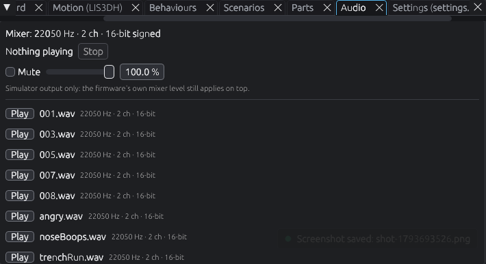

# Adding sounds

> **You'll need:** a sound file, a free sound editor such as [Audacity](https://www.audacityteam.org/), the simulator · **Time:** 15 minutes

Lola's sounds are WAV files in the `sounds/` folder. **They aren't included in the project or the downloads**, so you make or find your own and give them the names on the [Sound list](Sound-List). The board is fussy about their format, so every file must be saved the same way.

Only use sounds you're allowed to use: ones you recorded yourself, or ones whose licence lets you.

## Make a sound the robot can play

1. Open your sound in Audacity.
2. Set the project rate (bottom-left) to **22050 Hz**.
3. Make it **stereo**: if it's mono, choose **Tracks > Add New > Stereo Track** and paste it in, or duplicate the track and **Make Stereo Track**.
4. Choose **File > Export Audio…**.
5. Pick **WAV**, encoding **Signed 16-bit PCM**.
6. Give it a short name with no spaces, such as `beep.wav`, and save.

## Give her a sound

1. Name your file exactly as on the [Sound list](Sound-List), for example `noseBoops.wav` (capital letters matter).
2. Copy it into `PropMaker_Feather/sounds/` (make the folder if it isn't there), replacing any old one.
3. In the simulator, open the **Audio** panel and click **Play** next to it to hear it.
4. If it's shown in **red**, the robot can't play it: the panel says why. Export it again with the settings above.
5. Boop Lola in the simulator to hear it in action, then [copy it to the robot](Copy-the-Firmware).



## Add a new random start-up sound

Any WAV in `sounds/` might be picked as the sound she plays after start-up. Just drop it in.

## Play a sound from a behaviour

In a behaviour file, add a line like:

```python
await play_wav("beep.wav")
```

and add `play_wav` to the `from hardware import ...` line at the top if it isn't there.

### ✅ It should look like this

Your file shows in the **Audio** panel with no red, and plays when the behaviour runs. The **Log** shows `[sim] Sound: beep.wav`.

## ⚠️ Something went wrong?

| Problem | Fix |
|---|---|
| `ValueError: The sample's sample_rate does not match` | The file isn't 22050 Hz, stereo, 16-bit signed. Export it again. |
| The **Audio** panel says a file is missing | A `play_wav("…")` in the code names a file that isn't in `sounds/`. Check the spelling and capitals. |
| It plays in the simulator but not the robot | Copy the new file to **CIRCUITPY**'s `sounds` folder ([Copy the firmware](Copy-the-Firmware)). |

## More detail (for tinkerers)

- The mixer in `hardware.py` is `audiomixer.Mixer(voice_count=1, sample_rate=22050, channel_count=2, bits_per_sample=16, samples_signed=True)`. Every WAV must match it; the simulator raises the same `ValueError` as CircuitPython 9.2 when one doesn't.
- `play_wav(name, loop=False)` returns straight away. There's one voice, so a new sound stops the last one. `stop_wav()` stops a looped sound.
- The board's flash is small (about 8 MB on the Prop-Maker Feather). Keep sounds short.
- Full list of the names the firmware uses: [Sound list](Sound-List).
- `sounds/` is in `.gitignore`, so your files stay on your computer and never go into git.
