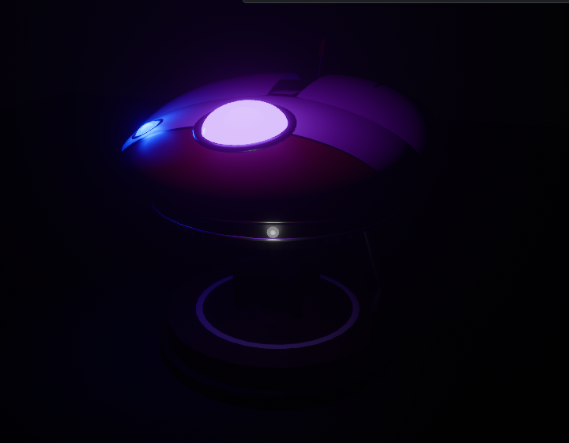
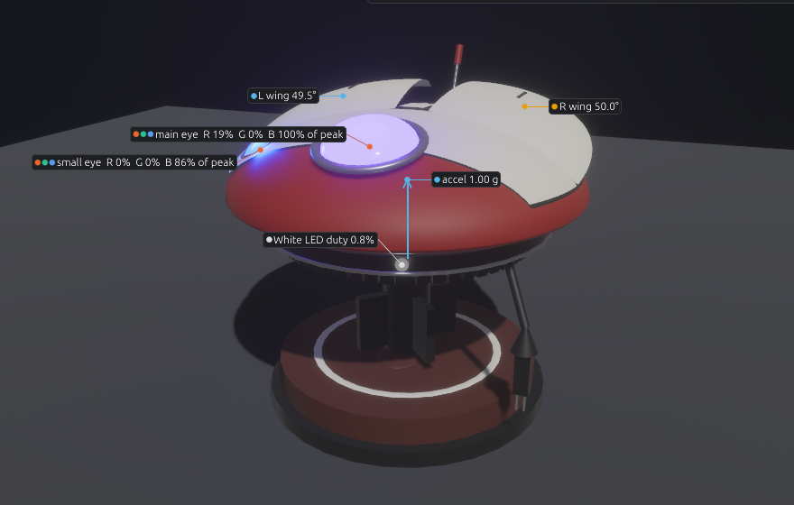

# Camera, overlays, screenshots and recording

> **You'll need:** the simulator open · **Time:** 5 minutes

Everything on this page is in the small toolbar at the top-right corner of the **3D view**.

## Move the camera

| To… | With the mouse | With the keyboard (click the 3D view first) |
|---|---|---|
| Turn around her | Drag with the left or right button | Arrow keys |
| Slide sideways | Drag with the middle button (the wheel) | Shift + arrow keys |
| Zoom | Scroll the wheel | **+** and **−** |
| Go back to the start | Click **Reset** | **Home** |

Or jump to a view: **Front**, **Side**, **Top**, or **Eyes** for a close-up of her eyes.

## Dim the room

Click **Light** and pick **Bright**, **Dim** or **Dark**. In the dark her eyes and white light glow and light up her body, just like in a dark bedroom.

## Show the numbers (overlays)

Click **Overlays** and tick any of:

- **Wing angles**: each wing's angle.
- **Eye colours**: how much red, green and blue each eye has.
- **White LED duty**: how bright the white light is.
- **Accelerometer arrow**: which way, and how hard, she's being pushed.

## Take a picture

1. Click **📷 Screenshot**.
2. A card says *Screenshot saved*. The picture is in the `captures` folder next to `ddl0-sim.exe`.

## Record a moving picture

1. Click **⏺ Record**.
2. Do the thing you want to record, such as booping her.
3. Click **⏹ Stop recording** (the same button) to stop. It stops by itself after 30 seconds.
4. The `captures` folder now has a numbered picture for every tenth of a second. Turn them into a GIF with any GIF maker, such as [ezgif.com](https://ezgif.com/maker) (drop in the pictures, set the delay to 10).

## ⚠️ Something went wrong?

- **The keys don't move the camera.** The 3D view needs to be focused: click it once, or press **F6** until its tab is active, then **Tab**. A ring goes round it.
- **Can't find the captures folder.** It's `captures`, in the same folder as `ddl0-sim.exe`.
- **The camera moves slowly instead of jumping.** That's the glide animation. Turn off **⚙ View > Animations** to make it jump.

## More detail (for tinkerers)

- The overlays use the same numbers as the **PCA9685** panel and the **Plot**, so they always agree. They show in screenshots and recordings, and your choice is remembered.
- The light from the eyes and white LED is in proportion to their duty, so **Dim** and **Dark** show how bright `EYE_MIN_BRIGHTNESS` or `WHITE_LED_IDLE_DUTY` will really look.
- Keyboard orbit steps 5° a press; holding a key keeps it moving.
