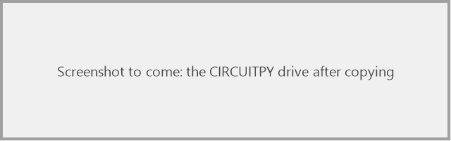
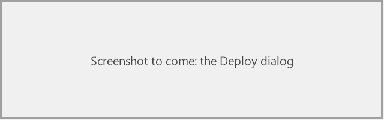

# Copy the firmware to the robot

> **You'll need:** a board with [CircuitPython installed](Install-CircuitPython), a copy of the project · **Time:** 5 minutes

The firmware is the set of files in the project's **`PropMaker_Feather`** folder. Copying them onto the **CIRCUITPY** drive puts them on the robot.

## The first time: copy by hand

1. From the [latest release](https://github.com/Aiddy81/DD-L0-LA59-Animatronics/releases/latest), download **`ddl0-firmware-…zip`** and extract it. (The simulator download and a Git copy have the same files in their `PropMaker_Feather` folder.)
2. Plug the Feather into your computer. The **CIRCUITPY** drive appears.
3. Open the extracted folder.
4. Select these and copy them onto **CIRCUITPY**, replacing anything already there:
   - `code.py`, `boot.py`, `config.py`, `hardware.py`, `log.py`, `log_off.py`, `settings.toml`
   - the folders `behaviours` and `lib`
5. Make a folder called `sounds` on **CIRCUITPY** and put your WAV files in it. The sounds aren't included in the project: see [Adding sounds](Adding-Sounds) for how to make them and the [Sound list](Sound-List) for the names.
6. Wait for the copy to finish. The board restarts by itself and Lola starts up.

> **Don't** copy or delete `boot_out.txt`: the board writes it itself.

### ✅ It should look like this

The board's wings sweep, its eyes light up and it plays a sound. Then it breathes.

## Every time after: Deploy from the simulator

Once the libraries are on the board, the simulator can copy just the files you changed.

1. Plug the robot in.
2. In the simulator, click **⬆ Deploy** at the right of the toolbar.
3. It lists the files that are new or changed. Check the list, then confirm.
4. Each file appears in the **Log** as `[sim] deployed …`. The board restarts once at the end.

<!-- TODO(owner): capture with the robot plugged in, as images/deploy-dialog.png -->

## ⚠️ Something went wrong?

| Problem | Fix |
|---|---|
| *No CIRCUITPY drive found* | Plug the robot in and wait for the drive to appear. Check your cable carries data. On Linux it's looked for under `/media/$USER/`, `/run/media/$USER/` or `/media/`; on a Mac under `/Volumes/`. |
| The board crashes with an error about `sounds/` | The `sounds` folder is missing on CIRCUITPY. Make it (step 5). |
| The copy fails: the drive is "read-only" | Logging mode is on. Turn it off first: see [Test it and read the log](Test-and-Read-the-Log#turn-logging-off). |
| The board's LED blinks and Lola does nothing | There's an error. Open the serial console to read it ([Test it and read the log](Test-and-Read-the-Log)). Did you copy `lib`? |
| *ImportError: no module named …* | The `lib` folder is missing or incomplete. Copy it again. |
| The wings don't move while it's plugged in | Normal: the wings can't run while the board is plugged into a computer. Unplug it and run on the battery. |

## More detail (for tinkerers)

- **Deploy** compares files byte for byte and copies only what's new or changed: the top-level `.py` files, `settings.toml`, `behaviours/` and `sounds/`. It never touches `lib/` or `boot_out.txt`, never deletes anything, never copies `log.txt` or `log_mode`, and copies `code.py` last so the board restarts once with everything in place.
- Deploy copies from the folder chosen with **🗁 Firmware**.
- Try every change in the simulator before deploying: [Try changes in the simulator](Try-Changes-in-the-Simulator).
