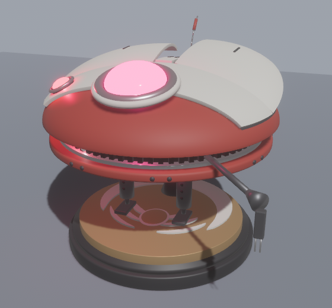
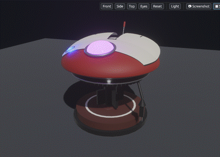
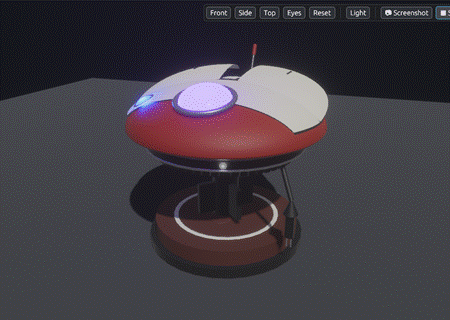
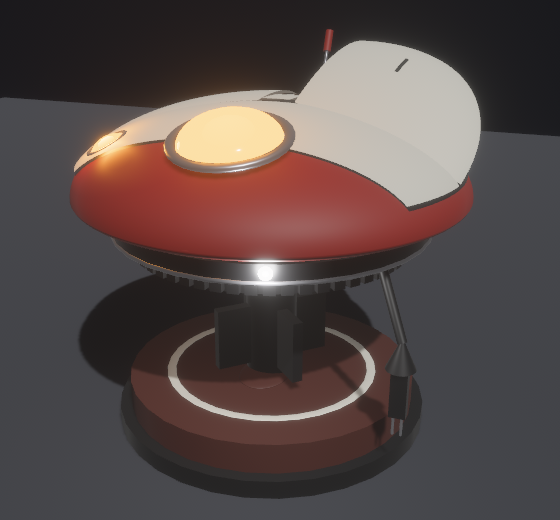
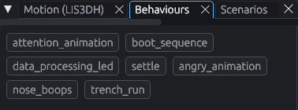

# Make her breathe, boop, get angry and want attention

> **You'll need:** the simulator open · **Time:** 10 minutes

Lola does five things on her own. Here's how to see each one.

## 1. Watch her start up and breathe

1. Click **🔄 Restart** in the toolbar (or press **R**).
2. Watch: her wings sweep and her eyes light up. This is the **boot sequence**. A random sound plays.
3. Then her wings slowly rise and fall, about once every 4 seconds, and her eyes glow brighter and dimmer. This is **breathing**, and she keeps doing it whenever nothing else is happening.

✅ The **Log** shows `Boot sequence complete!`.

## 2. Boop her nose

1. Click Lola's head once, quickly, without moving the mouse.
2. She flutters her wings and makes a happy sound.

Or use the **Motion (LIS3DH)** panel: click **Nudge** (or press **N**).

✅ The status bar says *Boop … g. Sound: noseBoops*.

> **Tip:** The longer you hold the mouse button on her, the harder the boop: a quick tap is gentle, a whole second is a hard poke.

## 3. Make her angry

There are two ways:

- **Annoy her:** boop her **3 times** within a minute or so. Wait for each flutter to finish before the next boop.
- **Shake her:** click **Hard shake** in the **Motion (LIS3DH)** panel (or press **S**).

She flaps hard and growls.

✅ The status bar says *Now angry animation* and the **Audio** panel shows `angry.wav`.

## 4. Make her want attention

Left alone, Lola waits a random time (15 minutes to 2 hours!) and then does one of two things, a coin flip:

- **Attention:** she calls "you-hoo!", flaps and her eyes cycle through colours.
- **Trench run:** a 2½-minute flight. Her wings tilt and dive, her eyes glow orange and her white light flickers.

You don't have to wait. Click **Trigger idle** in the toolbar (or press **I**). Click it again later to see the other one, as it's random.

To stop a trench run early, click **Hard shake**. A gentle nudge isn't enough while she's busy.

## 5. Watch the white light

Every so often (between 5 seconds and a minute) her white light flickers for a few seconds, as if she's thinking. You don't need to do anything.

## Make any behaviour happen right now

Open the **Behaviours** panel. It has one button per behaviour, such as **angry_animation** or **trench_run**. Click one to run it once.

## ⚠️ Something went wrong?

| Problem | Why, and what to do |
|---|---|
| Booping 3 times doesn't make her angry | The boops must be inside one "window" (1–3 minutes), and a boop during a flutter is ignored. Wait for each flutter to stop, then boop again. Or use **Hard shake**. |
| A boop does nothing | You may have dragged: that turns the camera. Or she's in an animation; use **Hard shake** to interrupt. |
| No sound | Check the **Audio** panel isn't on **Mute** and your speakers are on. Sounds are also listed in the **Log**. |
| The **Behaviours** buttons are greyed out | One is already running. Wait for it to finish. |

## More detail (for tinkerers)

- **Nudge** sends one accelerometer reading 0.3 g past the held value, in the **Direction** picked (default +Z). From rest that is 1.3 g on z, more than `NUDGE_Z_MG` (0.25 g), so it's a boop.
- **Hard shake** is 2 g past the held value (3 g from rest), over `HARD_MOTION_MG` (2.5 g), so it goes straight to angry.
- While the attention animation or trench run plays, the firmware needs a change bigger than `ANIMATION_NUDGE_Z_MG` (0.8 g), because the wings shake the board themselves. Only the trench run stops early for it; the attention animation is short (about 2½ s) and always finishes.
- The firmware only reads the z axis, so ±X and ±Y nudges are ignored, as on the robot.
- **Boop** with **boop strength (g)** and **Direction** does a click-boop from the keyboard (**B**).
- The **State** panel shows the nudge count against `ANGRY_NUDGES`, the time left in the angry window and the time left until the idle trigger.
- For every timing, see [Settings reference](Settings-Reference) and the [Behaviour table](Behaviour-Table).
