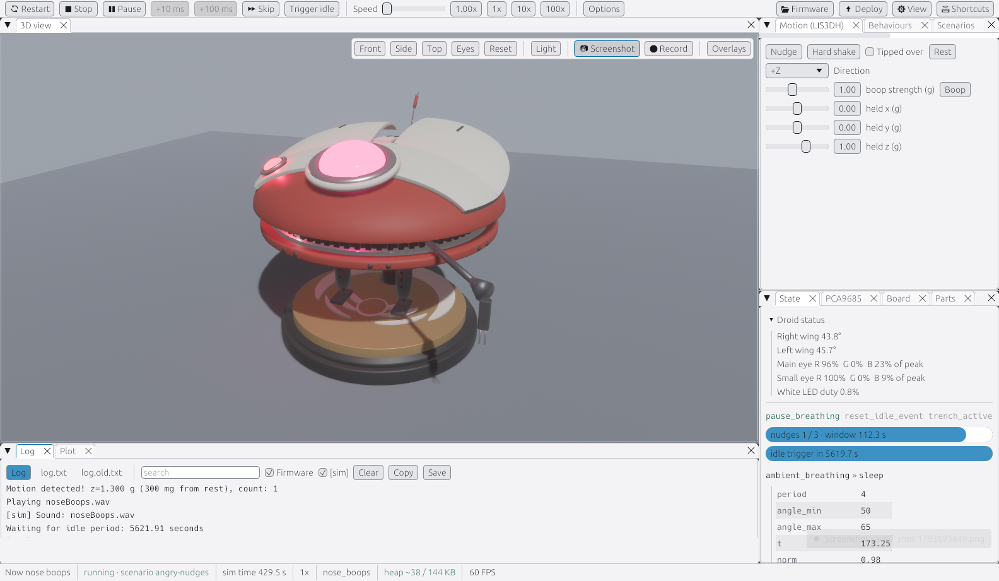
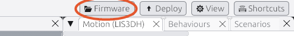

# Get the simulator

> **You'll need:** a Windows 10 or 11 computer · **Time:** about 10 minutes

The simulator is a Windows program. It comes as a folder with everything inside, including its own Python, so there's nothing else to install.

## Download and open it

1. Go to the project's [Releases page](https://github.com/Aiddy81/DD-L0-LA59-Animatronics/releases).
2. Under the newest release, click the file whose name starts with **`ddl0-sim`** and ends in **`.zip`** to download it.
3. Open your **Downloads** folder.
4. Right-click the ZIP file and choose **Extract All…**, then click **Extract**.
5. Open the new folder and double-click **`ddl0-sim.exe`**.
6. If Windows shows "Windows protected your PC", click **More info**, then **Run anyway**. This appears because the program is new and not signed by a big company.

> **Not on the Releases page yet?** Simulator downloads start with [issue #92](https://github.com/Aiddy81/DD-L0-LA59-Animatronics/issues/92). Until then, ask a grown-up or developer to [build it](Building-the-Simulator), or download the latest test build: open the [Simulator runs](https://github.com/Aiddy81/DD-L0-LA59-Animatronics/actions/workflows/simulator.yml), click the newest green ✅ run on `main`, and download **ddl0-sim-windows** at the bottom (you need to be signed in to GitHub). It's kept for 14 days.

### ✅ It should look like this

After a few seconds Lola appears and starts her start-up wiggle, then breathes slowly.

## Choose the firmware folder

The simulator needs the robot's code (the folder with `code.py` in it) to know what Lola should do.

- If you got the simulator inside a copy of the whole project, it finds the code by itself.
- If it can't, it asks you to pick a folder. Choose the **`PropMaker_Feather`** folder from your copy of the project.

To switch to a different copy later, click **🗁 Firmware** at the right of the toolbar.

## ⚠️ Something went wrong?

| What you see | Try this |
|---|---|
| Nothing happens when you double-click | Wait 10 seconds; the first start is slow. Check you extracted the ZIP: running the exe from inside the ZIP doesn't work. |
| "Windows protected your PC" with no *Run anyway* | Click **More info** first. If your computer is managed by a school or work, it may block new programs; ask whoever looks after it. |
| It asks for a folder and you don't have one | [Download the project ZIP](https://github.com/Aiddy81/DD-L0-LA59-Animatronics/archive/refs/heads/main.zip), extract it, and pick its `PropMaker_Feather` folder. |
| Lola looks simpler than in the pictures | There are two 3D models: **Lola** (detailed) and **Primitive** (simpler and faster). Pick one under **Model** in the toolbar's **Options**. |

More fixes: [Troubleshooting and FAQ](Simulator-Troubleshooting).

## Mac or Linux?

Not yet. That's [issue #93](https://github.com/Aiddy81/DD-L0-LA59-Animatronics/issues/93). This page will get steps for each one when it's done.

## More detail (for tinkerers)

- The simulator picks its firmware in this order: a `code.py` path given as the first command-line argument; the folder last chosen with **🗁 Firmware** (if it still has `code.py`); `PropMaker_Feather\code.py` in a folder above the exe. If none is found it asks.
- Its own files (3D model, `sim.toml`, `parts.toml`, scenarios) come from the `simulator\` folder above the exe, so the firmware can live anywhere: a copy, another checkout, or even the CIRCUITPY drive.
- Your settings are kept in `ddl0-sim.prefs.toml` next to the exe. Delete it to go back to the defaults.
- To build it yourself from the source code, see [Building the simulator](Building-the-Simulator).
