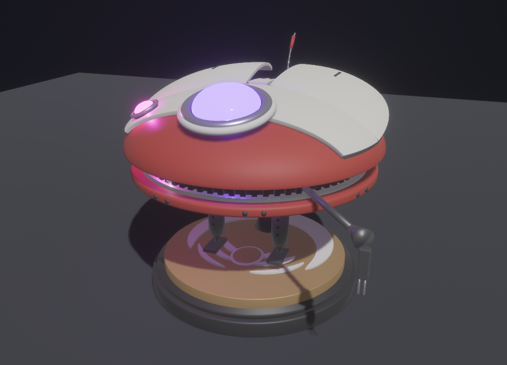

# Welcome to DD-L0-LA59

DD-L0-LA59 (we call her **Lola**) is a small robot droid that seems alive. She:

- **breathes**: her wings slowly rise and fall, and her eyes glow brighter and dimmer;
- **loves boops**: tap her nose and she flutters her wings and makes a happy sound;
- **gets angry**: poke her too often, or shake her, and she flaps hard and growls;
- **wants attention**: leave her alone for a while and she calls out to you, or goes on a "trench run" flight.

You don't need the robot to try her out. The **simulator** is a program for your Windows computer that shows Lola in 3D and runs the very same code as the real robot.

## Choose your path

| I want to… | Start here | You'll need |
|---|---|---|
| 🎮 **Try the simulator** | [Get the simulator](Get-the-Simulator) | A Windows computer |
| 🔧 **Build the robot** | [Parts list](Parts-List) | The parts, a soldering iron and an adult helper if you're under 16 |
| ✏️ **Change how she behaves** | [How the firmware works](How-the-Firmware-Works) | The simulator, a text editor |
| 💡 **Add new hardware** | [Adding new hardware](Adding-New-Hardware) | The simulator |
| 🧑‍💻 **Work on the simulator itself** | [Building the simulator](Building-the-Simulator) | Docker Desktop |

New to all this? Read [What you need](What-You-Need) first, and keep the [Glossary](Glossary) open for any word you don't know.

## About this wiki

- Pages start simple. Sections called **More detail (for tinkerers)** go deeper, so skip them if you just want things to work.
- Button and panel names are written exactly as they appear in the app, so you can find them on screen, or say them to Windows Voice Access ("click Nudge").
- Found a mistake or got stuck? [Open an issue](https://github.com/Aiddy81/DD-L0-LA59-Animatronics/issues/new) and tell us which page and which step.

The pages are kept in the [`wiki/` folder](https://github.com/Aiddy81/DD-L0-LA59-Animatronics/tree/main/wiki) of the project. See [Contributing and branching](Contributing-and-Branching) to change them.
