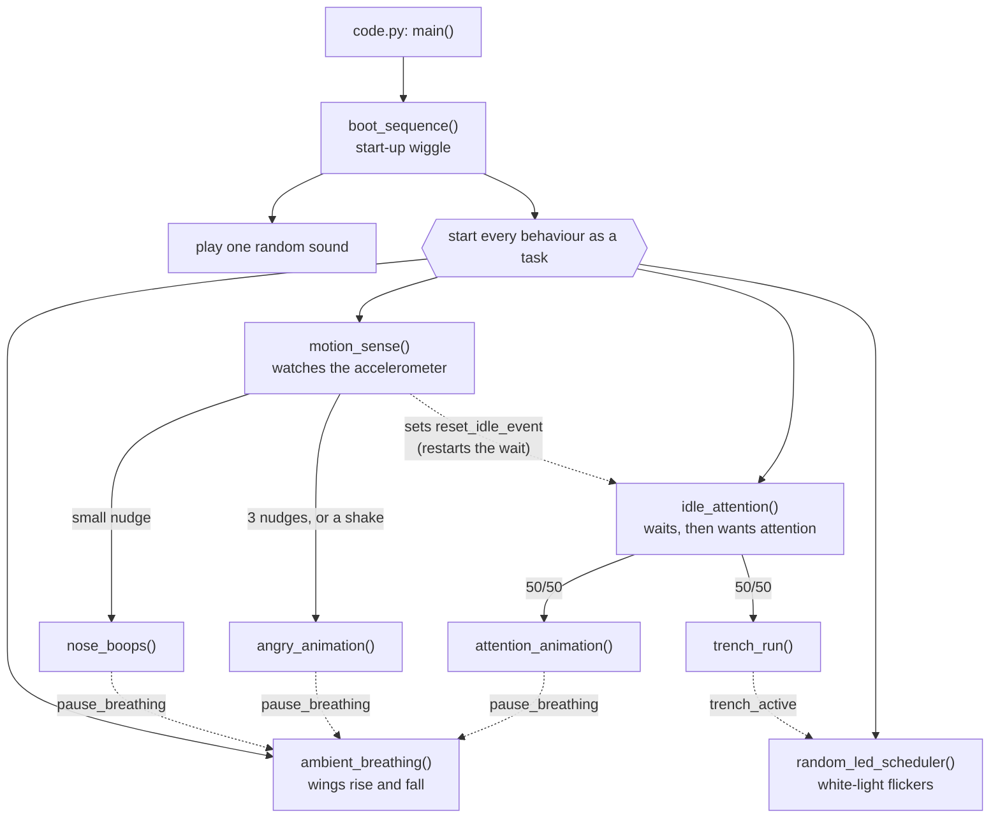

# How the firmware works

> **You'll need:** a copy of the project · **Time:** 10 minutes to read

## The simple version

Lola's code is a few Python files. One starts everything, one sets up the hardware, one reads your settings, and each behaviour has its own file.

| File | What it does |
|---|---|
| `code.py` | Starts here. Runs the start-up wiggle, then starts every behaviour at once. |
| `hardware.py` | Sets up the motors, lights, sensor and speaker. Says which part is on which channel. |
| `config.py` | Reads the numbers in `settings.toml`. |
| `settings.toml` | The numbers you can change. See [Settings reference](Settings-Reference). |
| `behaviours/` | One file per behaviour: `boot`, `breathing`, `motion`, `attention`, `trench_run`, `leds`. |
| `sounds/` | Her sound files. |
| `log.py`, `boot.py`, `log_off.py` | Messages, and saving them to `log.txt`. |
| `lib/` | Adafruit's ready-made libraries. Don't change these. |

All the behaviours run **at the same time**, taking turns very quickly. When one needs the wings, it tells the others to wait using a shared signal (an *event*).

The dotted lines are the **events**, in `hardware.py`:

- `pause_breathing`: "I'm using the wings, stop breathing for a moment."
- `reset_idle_event`: "Someone touched her, start the attention wait again."
- `trench_active`: "The trench run is using the white light, don't flicker it."

## More detail (for tinkerers)

- **asyncio, not threads.** Every behaviour is an `async def` running as a task. They only take turns at an `await`, so a behaviour must use `await asyncio.sleep()`, never `time.sleep()`: a blocking sleep freezes every other behaviour. The simulator warns `[sim] <task> held the loop for N ms without an await` when that happens.
- **Motion** reads only the accelerometer's z axis every 0.1 s, compared with the resting z measured after start-up and after each animation, so it works however the board is mounted. A change over `NUDGE_Z_MG` is a nudge; `ANGRY_NUDGES` nudges inside one random window (`ANGRY_MIN_WINDOW_S`–`ANGRY_MAX_WINDOW_S`), or z over `HARD_MOTION_MG`, is angry. While an animation owns the wings the limit is `ANIMATION_NUDGE_Z_MG`.
- **Idle** waits a random time between `IDLE_MIN_S` and `IDLE_MAX_S` for `reset_idle_event`. If it times out, it sets `pause_breathing` and runs attention or the trench run.
- **Sounds** start with `play_wav("name.wav")` in `hardware.py`, which returns straight away; a looped sound plays until `stop_wav()` or the next sound.
- **Eyes** are PCA9685 channels driven as 360° "servos": `mainEye_red.angle = 360` is full red. See the [Channel map](Channel-Map).
- **CircuitPython subset.** Stick to what CircuitPython 9 has: no `random.choices`, `os.path` or `asyncio.TaskGroup`. The simulator's **CircuitPython strict** catches these.
- **Add a behaviour:** write an `async def` in a `behaviours/` module. If it takes no arguments it gets its own button in the simulator's **Behaviours** panel automatically. To make it run on its own, start it from `code.py` or call it from another behaviour.
- See also the [Behaviour table](Behaviour-Table).
