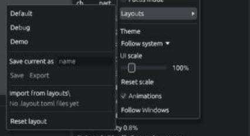
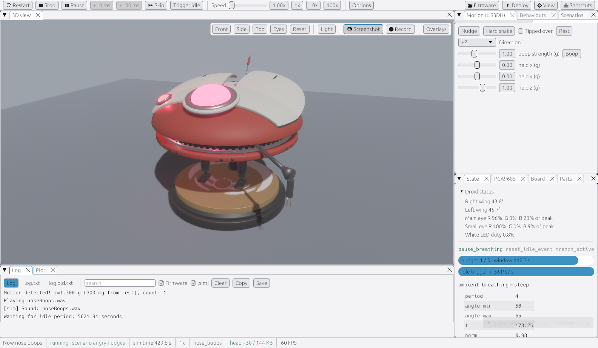
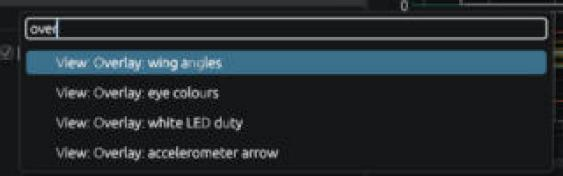

# Layouts, themes, the command palette and shortcuts

> **You'll need:** the simulator open · **Time:** 10 minutes

## Move panels around

- **Dock:** drag a panel's tab onto the edge of another panel to split, or onto its middle to put them together as tabs. Drag the lines between panels to resize.
- **Float:** right-click a tab and choose **Float** to make it a small window inside the simulator.
- **Detach:** right-click a tab and choose **Detach to window** to give it a window of its own, for example the log on a second screen. Click **Dock back** in that window to put it back.
- **Hide:** click the **×** on a tab. Bring it back from **⚙ View**.
- **Focus mode:** press **F11** to show only the panel you last clicked, full size. **F11** again goes back.

## Ready-made layouts

Open **⚙ View > Layouts** and pick one:

- **Default**: the normal arrangement.
- **Debug**: big log and plot, small 3D view.
- **Demo**: just Lola, for showing friends.

To keep your own arrangement, choose **Save current as** and type a name. **Reset layout** goes back to *Default*.

## Light or dark

Open **⚙ View > Theme** and pick **Follow system**, **Light**, **Dark** or **High contrast**. *Follow system* matches your Windows settings.

Most pictures in this wiki use the **Light** theme or the **Dark** one; the buttons are in the same places in every theme.

## Bigger or smaller text

- **Ctrl+=** makes everything bigger, **Ctrl+-** smaller.
- **Ctrl+0** goes back to Windows' text size.
- Or use **⚙ View > UI scale**.

## The command palette

The quickest way to do anything:

1. Press **Ctrl+K** (or choose **⚙ View > Command palette…**).
2. Type a few letters, such as `boop` or `th da` for *Theme: Dark*.
3. Press **Enter**.

## Keyboard shortcuts

Press **?** or **F1** for the full list in the **Shortcuts** panel. The main ones:

| Key | Does |
|---|---|
| **Space** | Pause / resume |
| **R** | Restart |
| **N** | Nudge (a boop) |
| **S** | Hard shake |
| **B** | Boop with the Motion panel's strength and direction |
| **I** | Trigger idle |
| **F** | Skip to the next event |
| **.** | Step 100 ms while paused |
| **Ctrl+K** | Command palette |
| **F6** / **Shift+F6** | Next / previous panel |
| **F11** | Focus mode |

Keys don't work while you're typing in a text box, such as the log's search.

## ⚠️ Something went wrong?

- **My layout is a mess.** **⚙ View > Layouts > Reset layout**.
- **A detached window opened off-screen.** Close and reopen the app: windows that would be off-screen are moved back onto your main screen.
- **Want to start completely fresh?** Close the app and delete `ddl0-sim.prefs.toml` next to `ddl0-sim.exe`.

## More detail (for tinkerers)

- **⚙ View > Layouts > Export** writes the layout to `simulator\dist\layouts\<name>.layout.toml`; files there show under **Import from layouts\\**.
- The keys, tooltips, **Shortcuts** panel and command palette all read one table (`SHORTCUTS` in `simulator/src/ui.rs`), so they can't disagree.
- Each detached window has its own UI scale.
- Remembered between runs: window size and place, layout, saved layouts, Model, Light, Theme, UI scale, Animations, overlays, toolbar checkboxes, volume and mute, log toggles and the plot's settings. Speed always starts at 1x.
