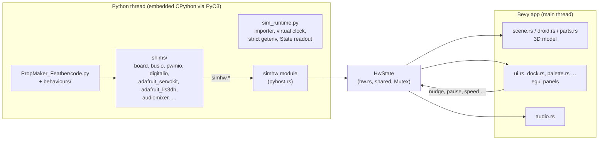

# Simulator architecture

The simulator runs the **unmodified** firmware against Python stand-ins (shims) for the hardware modules, and renders the droid in 3D.

## The pieces

| Part | Files | Job |
|---|---|---|
| **Python host** | `pyhost.rs` | Embeds CPython with PyO3, runs `code.py` on its own thread, restarts it, and exposes the `simhw` module. |
| **Shared state** | `hw.rs` | `HwState`: PCA9685 duties, pins, accelerometer, audio, parts, run state. Python writes, Bevy reads, behind one `Mutex`. `reset_for_run` clears it on restart. |
| **Shims** | `simulator/shims/*.py` | Mirror the CircuitPython/Adafruit API the firmware uses and forward to `simhw`. They do the real hardware maths (angle → pulse → duty at 50 Hz; LIS3DH clipping). |
| **Runtime** | `shims/sim_runtime.py` | The import hook (CircuitPython-strict mode), virtual clock (speed, pause, step, board timing), `getenv` from `settings.toml`, and the State panel's coroutine readout. |
| **3D** | `scene.rs`, `droid.rs`, `parts.rs` | Bevy scene: the Lola glTF or primitive model, wing hinges from `sim.toml`, glowing eyes, parts. |
| **UI** | `ui.rs`, `dock.rs`, `layout.rs`, `palette.rs`, `theme.rs`, `toast.rs`, `overlay.rs`, `part_edit.rs` | egui panels in an egui_dock layout, command palette, themes, notifications, overlays, parts editor. The `SHORTCUTS` table in `ui.rs` feeds keys, tooltips, the Shortcuts panel and the palette. |
| **Accessibility** | `a11y.rs`, `announce.rs` | AccessKit names and the status-line live region. |
| **Other** | `audio.rs`, `wav.rs`, `capture.rs`, `deploy.rs`, `settings.rs`, `editor.rs`, `prefs.rs`, `config.rs` | Sound, WAV checks, screenshots, Deploy, the Settings panel, opening tracebacks in an editor, saved preferences, `sim.toml`/`parts.toml` parsing. |

## Key versions

Pinned in `simulator/Cargo.toml`: Bevy `=0.17.3`, bevy_egui `=0.38.1` (egui 0.33, AccessKit on), egui_plot `=0.34.1`, egui_dock `=0.18.0`, PyO3 `=0.25.1` (abi3, Python 3.11+). Major version upgrades need the maintainer's OK.

## More detail (for tinkerers)

- The firmware's clock is virtual: speed, pause and step act on it, and **Board speed** charges each hardware call the time it takes on the RP2040.
- The simulated CIRCUITPY drive is `PropMaker_Feather/` with `dist\fs\` layered on top for writes, read-only to the firmware until `boot.py` remounts it, as on the board.
- Rules for shims and when Rust is needed: the [shim guide](https://github.com/Aiddy81/DD-L0-LA59-Animatronics/blob/main/simulator/docs/custom-shims.md).
- Adding a kind of output: [Adding a part kind](Adding-a-Part-Kind).
