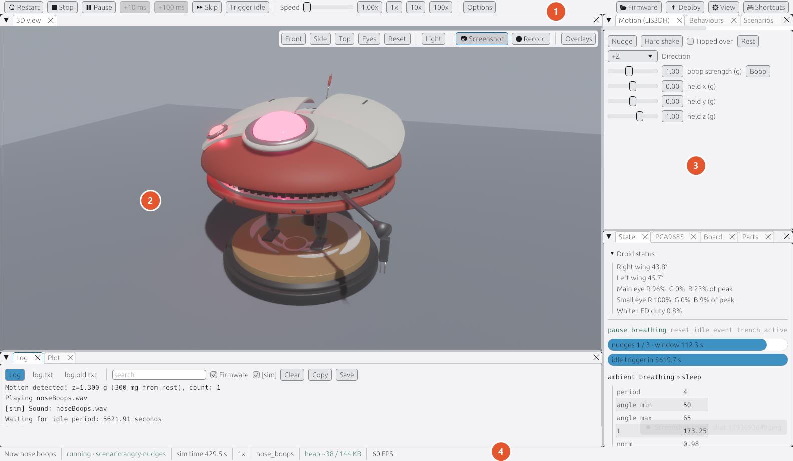
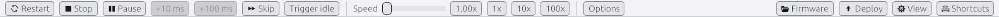
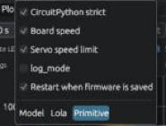
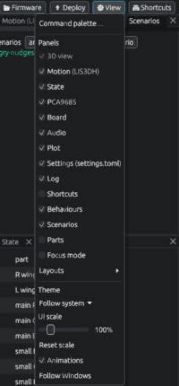
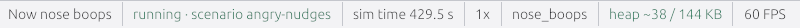

# A tour of the window

> **You'll need:** the simulator open ([Get the simulator](Get-the-Simulator)) · **Time:** 5 minutes

The window has four parts. Each has a number in the picture below.

(The log at the bottom is a panel too.)

## 1. The toolbar (top)

Buttons are in groups:

- **Run**: **▶ Run** (or **🔄 Restart** while running), **⏹ Stop**, **⏸ Pause** / **▶ Resume**, **+10 ms**, **+100 ms**, **⏩ Skip** and **Trigger idle**.
- **Speed**: a slider and **1x**, **10x**, **100x** buttons to make time go faster.
- **Options**: switches such as **CircuitPython strict**, **Board speed**, **Servo speed limit**, **log_mode**, **Restart when firmware is saved** and **Model**.
- On the right: **🗁 Firmware** (which code to run), **⬆ Deploy** (copy the code to the robot), **⌨ Shortcuts** (the list of keys) and **⚙ View** (panels, layouts, theme and size).

If the window is narrow, some groups fold into drop-down buttons, or a **More** menu. The buttons inside are the same.

Here **Options** has folded into a drop-down:

## 2. The 3D view (middle)

This is Lola. Drag with the mouse to turn around her, scroll to zoom. **Click her to boop her!**

Its small toolbar in the top-right corner has the camera buttons (**Front**, **Side**, **Top**, **Eyes**, **Reset**), **Light**, **📷 Screenshot**, **⏺ Record** and **Overlays**. See [Camera, overlays and recording](Camera-Overlays-and-Recording).

## 3. The panels (around the 3D view)

Each panel is a tab with a title. The ones you'll use most:

| Panel | What it's for |
|---|---|
| **Motion (LIS3DH)** | Poke her: **Nudge**, **Hard shake**, **Boop**, **Tipped over**, **Rest**. |
| **Behaviours** | One button per behaviour, to make her do it right now. |
| **Log** | Messages from the firmware and the simulator. |
| **State** | What she's doing right now, in words. |
| **Audio** | What sound is playing, and volume. |

The others, **Scenarios**, **PCA9685**, **Board**, **Plot**, **Settings (settings.toml)**, **Parts** and **Shortcuts**, are explained on [Speed, scenarios and panels](Speed-Scenarios-and-Panels).

Hidden a panel by mistake? Open **⚙ View** and tick it again.

## 4. The status bar (bottom)

The left end shows the latest thing that happened, in words, such as *Boop 1.0 g. Sound: noseBoops*. Then whether it's running, the time, the speed, what Lola is doing and how much memory she's using.

### ✅ Check

Click Lola's head once. The status bar should say something like *Boop 0.3 g* and she flutters her wings. Next: [Make her breathe, boop and more](Droid-Behaviours).

## ⚠️ Something went wrong?

- **A panel is missing.** **⚙ View** lists every panel with a tick. Or choose **⚙ View > Layouts > Reset layout**.
- **Everything is tiny or huge.** Press **Ctrl+0** to go back to Windows' text size, or **Ctrl+=** / **Ctrl+-** to change it.
- **Clicking her turns the camera instead of booping.** A drag turns the camera. Click without moving the mouse.

## More detail (for tinkerers)

- Small cards in the bottom-right corner tell you about screenshots, reloads and errors. Click a red error card to jump to it in the **Log**.
- Every button has a tooltip that shows what it does and its key. All of them are also in the command palette (**Ctrl+K**).
- The status bar's behaviour is the one a **Behaviours** button started, or else the function a task is running (from the **State** panel), or else *breathing*.
