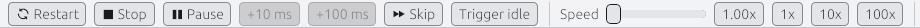
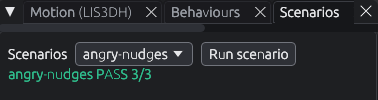
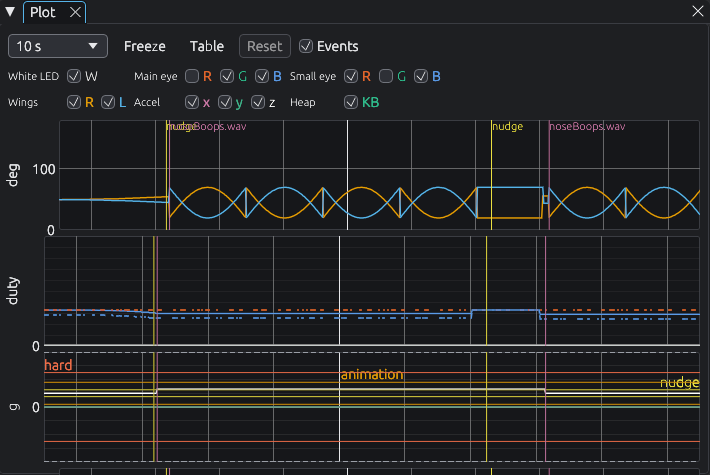

# Speed, pause, scenarios and the other panels

> **You'll need:** the simulator open · **Time:** 15 minutes

## Make time go faster

Lola can wait up to 2 hours before asking for attention. You can speed time up:

- Drag the **Speed** slider (1x to 200x), or click **1x**, **10x** or **100x**.
- Or click **⏩ Skip** (key **F**): time races until the next thing happens, such as a sound or an animation, then goes back to 1x. Click **⏹ Stop skip** to end it early.

## Pause and step

1. Click **⏸ Pause** (or press **Space**). Lola freezes.
2. Click **+10 ms** or **+100 ms** (key **.**) to move time forward a tiny bit. Great for seeing a fast flap frame by frame.
3. Click **▶ Resume** (or **Space**) to carry on.

## Scenarios: automatic tests

A scenario pokes Lola at set times and checks she reacts the right way.

1. Open the **Scenarios** panel.
2. Pick a scenario from the list, such as `angry-nudges`.
3. Click **Run scenario**.
4. Watch the badge: *running*, then **PASS** or **FAIL**. Hover over it to see each check.

The ones that come with it: `boot`, `breathing`, `boop`, `angry-nudges`, `angry-shake`, `idle` and `sideways-nudge`.

## The other panels

| Panel | What it shows |
|---|---|
| **State** | **Droid status** at the top: her wing angles, eye colours and white light, in words. Below: which "events" are on, the nudge count, the time until she wants attention, and what each part of the code is doing right now. |
| **Plot** | Graphs over time: wing angles, light levels, the accelerometer and memory. Lines mark boops, sounds and restarts. Click **Table** for numbers instead of graphs, **Freeze** to hold still. |
| **PCA9685** | Each of the 8 outputs on the servo board: its pulse and what it means (wing angle or eye colour). |
| **Board** | How much memory the code uses compared with the real board, and any slow spots. |
| **Audio** | What's playing, a volume slider, **Mute**, and every sound file with a **Play** button. A file the robot couldn't play is shown in red. |
| **Settings (settings.toml)** | Every setting you can tune, with a **Save** and **Revert** button. See [Try changes in the simulator](Try-Changes-in-the-Simulator). |
| **Log** | Messages. Use the search box, and the **Firmware** and **[sim]** switches to show one kind. **Clear**, **Copy**, **Save**. |
| **Parts** | Add extra lights, buttons and moving pieces to Lola. See [Adding new hardware](Adding-New-Hardware). |
| **Shortcuts** | Every key and mouse action. |

## ⚠️ Something went wrong?

- **A scenario says FAIL.** Hover the badge to see which check failed, and look in the **Log** for `[sim] scenario` lines. If you changed the firmware, your change may have broken a behaviour; that's what scenarios are for.
- **Speed won't go back to normal.** Click **1x**. Speed always starts at 1x when you open the app.
- **+10 ms and +100 ms are greyed out.** They only work while paused.

## More detail (for tinkerers)

- **Skip** runs at 1000x until a sound plays or an event in `hardware.py` changes. Breathing and white-LED flashes don't stop it, so one click gets through the idle wait.
- **Trigger idle** ends the idle wait at once (50/50 attention or trench run).
- The **State** panel reads the firmware's running coroutines 10 times a second, so new events, tasks and number variables show up without any simulator change. The two countdown bars read `motion_count`, `angry_window_start`, `angry_window_length` and `idle_attention`'s `wait_for` by name.
- The **Plot**'s accelerometer band shows `NUDGE_Z_MG` (yellow), `ANIMATION_NUDGE_Z_MG` (orange), `HARD_MOTION_MG` (red) and the sensor's clip level (dashed grey). The heap band shows the board budget (red) and 80% (amber).
- Scenario files are TOML in `simulator/scenarios/`; a new file shows up within a second. The format is in the [README's Scenarios section](https://github.com/Aiddy81/DD-L0-LA59-Animatronics#scenarios).
- **Board speed** makes every hardware write and read take as long as on the RP2040; **Servo speed limit** stops the 3D wings turning faster than the real servo. Keep both on to see what the robot will really do.
