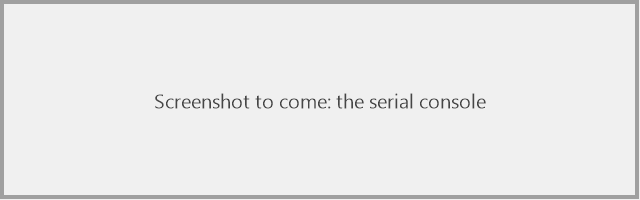
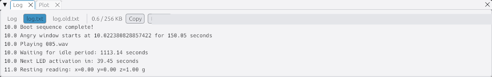

# Test it and read the log

> **You'll need:** the robot with firmware on it, the simulator · **Time:** 15 minutes

## Test checklist

Do these in order. Tick each one.

- [ ] **Start-up:** power on. The wings sweep, the eyes light up, a sound plays.
- [ ] **Breathing:** the wings rise and fall slowly, the eyes glow brighter and dimmer.
- [ ] **Boop:** tap her gently. She flutters and plays `noseBoops.wav`.
- [ ] **Angry:** tap her 3 times (waiting for each flutter to end), or shake her. She flaps hard with red eyes and plays `angry.wav`.
- [ ] **Attention:** hard to test with a 15-minute to 2-hour wait. Set `IDLE_MIN_S = 60` and `IDLE_MAX_S = 120` in `settings.toml`, wait 1–2 minutes, then put them back.

## Reading messages while plugged in (serial console)

The firmware prints messages as it runs, such as `Boot sequence complete!`. To see them:

1. Plug the robot in.
2. Open a serial console. The easiest is the web one at [code.circuitpython.org](https://code.circuitpython.org/): click **Connect**, pick **USB**, and choose the board.
3. Messages appear as they happen. Press **Ctrl-D** to restart the code.

<!-- TODO(owner): screenshot of the serial console showing the start-up messages, as images/log-serial.png -->

## Saving messages while on battery (logging mode)

The wings can't run while the board is plugged into a computer, so to see what happens on battery, save the messages to a file.

### Turn logging on

1. Plug the robot in.
2. On **CIRCUITPY**, make a new empty file called exactly `log_mode`, with **no** `.txt` on the end. (In File Explorer: **View > Show > File name extensions** helps you check.)
3. Press the board's **RESET** button. (Ctrl-D isn't enough.)

### Run and read

4. Unplug and run on battery. Play with her.
5. Plug back in. Copy `log.txt` off **CIRCUITPY** and open it.

Each run starts with `=== DD-L0-LA59 starting ===`, and every line starts with the seconds since power-on.

> While logging is on, the drive is **read-only** for your computer: you can copy files off, but not change them.

### Turn logging off

1. Open the serial console (see above).
2. Press **Ctrl-C**.
3. Type `import log_off` and press **Enter**.
4. The board restarts and the drive can be changed again.

### Try it in the simulator first

Tick **log_mode** in the toolbar's *Options* and click **🔄 Restart**. A **log.txt** tab appears next to **Log**.

## ⚠️ Something went wrong?

| Problem | Fix |
|---|---|
| No `log.txt` | Check the file is called `log_mode` and not `log_mode.txt`. Press **RESET**, not Ctrl-D. |
| The log stops early | At 256 KB it moves to `log.old.txt` and starts again. Look there too. |
| I can't edit files on CIRCUITPY | Logging is on. [Turn it off](#turn-logging-off). |
| A boop doesn't work on the robot but does in the simulator | Check `Animation peak z change` lines in the log, and see `NUDGE_Z_MG` in the [Settings reference](Settings-Reference). Mounting can change how hard a tap feels. |

## More detail (for tinkerers)

- `boot.py` remounts the drive writable for the firmware when `/log_mode` exists. `log.py` appends every `log()` line to `/log.txt`, written straight to flash, so a pulled battery loses at most one line. A write can take a few milliseconds.
- In the simulator the file lands in `simulator\dist\fs\log.txt`, never in your project.
- To measure your robot's real speed and memory for the simulator, see "Matching the real board" in the [README](https://github.com/Aiddy81/DD-L0-LA59-Animatronics#matching-the-real-board) (`simulator/board_bench.py`).
