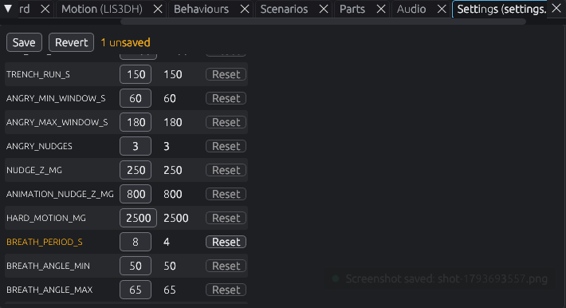
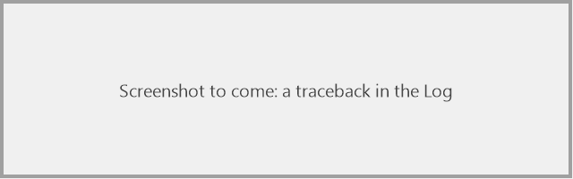

# Try changes in the simulator first

> **You'll need:** the simulator, a copy of the project, a text editor · **Time:** 10 minutes

The simulator runs your real code, so it's the safe place to try a change before the robot.

## Change a setting

1. Open the **Settings (settings.toml)** panel.
2. Change a value, for example `BREATH_PERIOD_S` from `4` to `8`. It turns amber: not saved yet.
3. Click **Save**. This writes it into `settings.toml`.
4. Click **🔄 Restart** (or tick **Restart when firmware is saved** in the toolbar's *Options* to restart by itself).
5. Watch her breathe twice as slowly.

Changed your mind? **Revert** throws away unsaved changes, and each setting has a **Reset** button for its default.

## Change the code

1. Tick **Restart when firmware is saved** in the toolbar's *Options*.
2. Open a file from the `PropMaker_Feather` folder in your editor, such as `behaviours/motion.py`.
3. Make a small change. For example in `nose_boops`, change `boops=2` to `boops=4` for more flutters.
4. Save. The simulator restarts with your change and shows *Firmware reloaded*.
5. Boop her to see it.

### If you make a mistake

The **Log** shows a red error (a *traceback*), and a red card pops up. Click the **blue line** in the log to open the file at the line with the problem. Fix it and save again.

<!-- TODO(owner): capture a traceback (e.g. a deliberate typo in a behaviour) with local paths hidden, as images/try-traceback.png -->

## Check nothing else broke

1. Open the **Scenarios** panel.
2. Run each scenario. All should say **PASS**.

## Then put it on the robot

Click **⬆ Deploy** ([Copy the firmware](Copy-the-Firmware)).

## ⚠️ Something went wrong?

| Problem | Fix |
|---|---|
| Saving my file doesn't restart | Tick **Restart when firmware is saved**, or press **R**. Make sure you're editing the folder shown by **🗁 Firmware**. |
| `ImportError` or `AttributeError` in red | You used something CircuitPython doesn't have. Keep **CircuitPython strict** on: the robot would fail the same way. |
| Clicking the blue line doesn't open my editor | It uses VS Code by default. Change `[editor] command` in `simulator/sim.toml`, or set it to `""` to open the folder instead. |
| A wing warning: `can't keep up` | Your animation asks the servo to move faster than it can. It will look slower on the robot. |

## More detail (for tinkerers)

- Keep **Board speed** and **Servo speed limit** on: they make timing and wing speed match the real RP2040 and FS90.
- The **Board** panel's heap gauge estimates memory use. Over 80% is a warning sign; the robot has far less memory than a PC.
- Every saved change to `code.py`, a module under `PropMaker_Feather/` or `settings.toml` restarts the run. Changes to `simulator/sim.toml` apply live without a restart.
- To test without a window (or in CI): `python simulator/tests/headless.py` runs the firmware and every scenario. See [CI and releases](CI-and-Releases).
