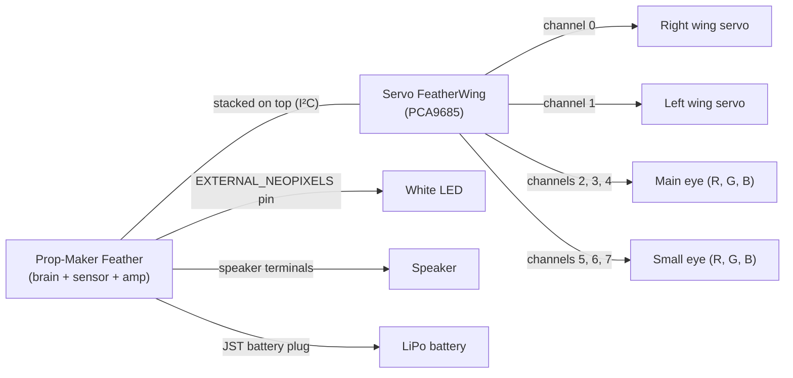

# Wiring

> **You'll need:** the [parts](Parts-List), soldering tools, an adult helper if you're under 16 · **Time:** 1–2 hours
>
> ⚠️ **Unplug USB and the battery before you start.** Read [Safety first](Hardware-Safety).

## The plan

**The channel numbers matter.** The firmware expects each part on exactly this channel. The full table is on the [Channel map](Channel-Map).

## Steps

1. **Solder headers** onto the Feather and the FeatherWing so they stack. Follow Adafruit's guides for the [Prop-Maker Feather](https://learn.adafruit.com/adafruit-rp2040-prop-maker-feather) and the [Servo FeatherWing](https://learn.adafruit.com/adafruit-8-channel-pwm-or-servo-featherwing).
2. **Stack** the FeatherWing on the Feather, matching the pin labels.
3. **Plug the right wing servo** into servo header **0** on the FeatherWing. The brown (or black) wire goes to the pin marked **GND**.
4. **Plug the left wing servo** into servo header **1**, the same way round.
5. **Wire the main eye**: red leg to the PWM pin of channel **2**, green to **3**, blue to **4**, and the long shared leg (cathode) to **GND**.
6. **Wire the small eye**: red to channel **5**, green to **6**, blue to **7**, shared leg to **GND**.
7. **Wire the white LED** to the Feather's external NeoPixel connection (`EXTERNAL_NEOPIXELS`) and ground, with a resistor in series.
8. **Connect the speaker** to the Feather's speaker terminals.
9. **Power for the servos:** give the FeatherWing's servo power terminal the supply your build uses.
10. Plug in the battery last.

<!-- TODO(owner): confirm steps 7 and 9 against the real build (which connector the white LED uses, its resistor value, and how the servos are powered), and add photos as images/wiring-*.jpg -->

### ✅ It should look like this

- Servo 0 is the right wing and servo 1 the left wing (looking from behind the droid).
- Every LED's shared leg goes to GND.

## ⚠️ Something went wrong?

Check these once the firmware is on ([Copy the firmware](Copy-the-Firmware)):

| Problem | Likely cause |
|---|---|
| A wing doesn't move | Servo plugged in backwards, or on the wrong header. Check brown/black is on GND. |
| The wings move the wrong way, or the left one moves like the right | The servos are swapped: right wing must be on 0. |
| An eye is the wrong colour | Two colour legs swapped. Red should be on the lower channel number. |
| An eye is bright when it should be dark | You have a common-anode LED. Use common-cathode ones. |
| Nothing happens at all, and the board's LED blinks red | An error in the firmware or a loose FeatherWing. Read the serial console ([Test it and read the log](Test-and-Read-the-Log)). |

## More detail (for tinkerers)

- The eyes are driven as "servos" on the PCA9685 with a pulse range of 0–6550 µs. At 50 Hz (20 ms) that tops out at about 32.8% duty, so the eyes never reach full PWM brightness. The simulator shows the same.
- The FeatherWing shares the I²C bus (`board.SCL`, `board.SDA`) with the Feather's LIS3DH; `hardware.py` makes one bus and gives it to both.
- `hardware.py` turns on `board.EXTERNAL_POWER` at start-up, which powers the Feather's external outputs.
- The wing pulse range is 544–2400 µs. Don't change it: it matches the servos. See [Calibrate the wings](Calibrate-the-Wings).
